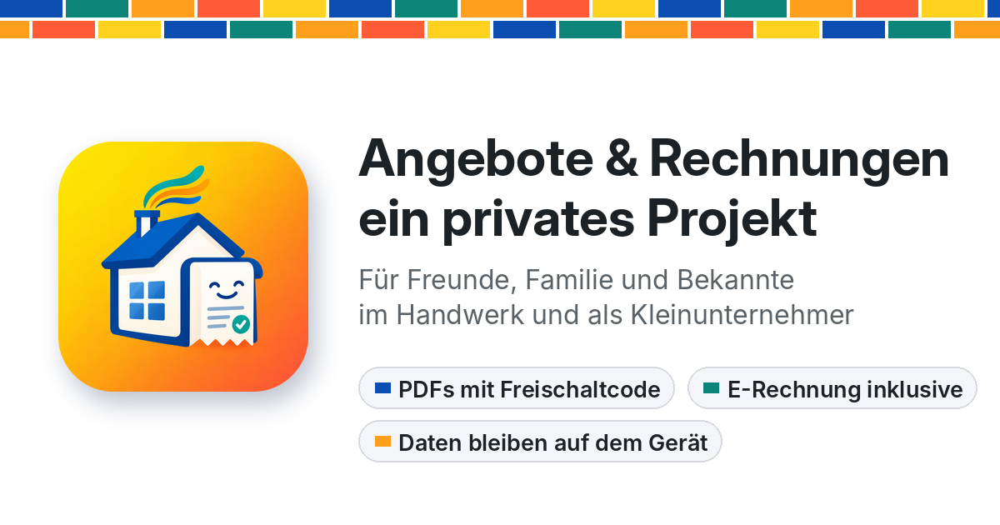

# Angebote & Rechnungen – ein privates Projekt

Ein Hobbyprojekt für Freunde, Familie und Bekannte, die Angebote und Rechnungen schreiben, zum Beispiel im Handwerk oder als Kleinunternehmer. Ohne Anmeldung und ohne Abo. Nach dem einmaligen Einrichten ist eine Rechnung in etwa 2 Minuten fertig.

**Der Haken:** PDFs lassen sich nur mit einem Freischaltcode erstellen. Den gibt es kostenlos auf persönliche Anfrage beim Ersteller, die Kontaktdaten stehen im Impressum der Website. Einrichten, Ausfüllen und die Vorschau gehen auch ohne Code.

**Zum Programm:** [peter-unruh.github.io/angebote-und-rechnungen](https://peter-unruh.github.io/angebote-und-rechnungen/)

## Was es kann

- Angebote, Rechnungen, Abschlags- und Schlussrechnungen als PDF
- E-Rechnung im Format ZUGFeRD, automatisch inklusive
- Kleinunternehmer (§ 19 UStG) und Bauleistungen (§ 13b UStG)
- Kunden, Positionen und Nummern werden gemerkt, offene Rechnungen bleiben im Blick
- Läuft im Browser, auch ohne Internet und als App auf Handy und Computer
- Über 200 kleine Sprüche, die nach getaner Arbeit gute Laune machen

## Ohne Gewähr

Ein privates Projekt, kein Produkt. Es ersetzt keine Steuer- oder Rechtsberatung, und es gibt keinen Anspruch auf Freischaltcode, Hilfe oder neue Versionen. Feedback und Hinweise auf Fehler sind trotzdem willkommen.

## Datenschutz

Alle Daten bleiben auf dem Gerät. Kunden, Angebote, Rechnungen und Firmendaten werden nur im Browser gespeichert. Das Programm schickt nichts ins Internet, lädt keine fremden Schriften oder Skripte und nutzt keine Cookies und keine Statistik-Dienste. Beim Aufruf der Seite verarbeitet nur GitHub als Anbieter, wie bei jeder Webseite, technische Daten wie die IP-Adresse. Details in `impressum.html`.

## Nutzen

- **Online:** Seite öffnen und über das Browser-Menü als App installieren („Zum Home-Bildschirm“ bzw. „App installieren“). Danach läuft sie auch ohne Internet.
- **Als Datei:** `index.html` herunterladen und im Browser öffnen.

Die Daten liegen je Browser getrennt. Mit „Einstellungen → Datensicherung“ lassen sie sich sichern und auf ein anderes Gerät übertragen. In Chrome und Edge am Computer geht das auch automatisch in einen Ordner.

Eine ausführliche Anleitung gibt es im Programm unter „Einstellungen → Anleitung (PDF)“.

## Neue Version veröffentlichen

1. In `index.html` oben im Skript `APP_VERSION` und `APP_VERSION_DATE` erhöhen und in `CHANGES` eintragen, was neu ist. Den Text der Anleitung findet ihr im Skript unter `HELP`.
2. In `sw.js` den Namen in `CACHE` anpassen (aktuell `angebote-rechnungen-2.2`).
3. Beide Dateien hochladen. Beim nächsten Öffnen sehen Nutzer einmal den Hinweis „Neu: Version …“.
